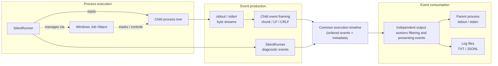

# Architecture Overview

SilentRunner is organized as an event-driven processing pipeline rather
than a monolithic command wrapper.



Child stdout and stderr are captured as byte streams and divided into
individual events according to the configured child event framing.
SilentRunner diagnostics are produced as diagnostic events.
All these events then enter a common execution timeline.

The execution timeline establishes a common ordering for all events.
Independent output workers consume events from that timeline, filter
them according to their configuration, and expose them through parent
stdout/stderr or persistent TXT and JSONL log files.

Child process execution is managed separately from stdout/stderr capture and event
processing. The child process tree is tracked and controlled through Windows
Job Object integration, including process-tree termination and debug monitoring.

## Child Event Model

### Framing

Framing determines how captured child stdout and stderr byte streams are divided
into individual events before those events enter the execution
timeline.

Stdout and stderr framing are configured independently.

With `chunk` framing, each underlying read chunk becomes one event.
This is the default behavior.

With `lf` or its alias `newline`, an event ends when LF is encountered. With
`crlf`, an event ends only when an exact CRLF sequence is encountered.

When a child stream ends, any remaining bytes form the final event.

### Event Metadata

Each event entering the execution timeline carries metadata describing its
payload type, timestamp, execution identity, phase, event ordering, payload size, and
related processing state. SilentRunner diagnostic events additionally include
diagnostic severity.

Important metadata fields include:

- `payloadType` -- Identifies child stdout, child stderr, or a SilentRunner
  diagnostic event.
- `tsUtc` -- UTC event timestamp with millisecond precision.
- `executionId` -- Identifies the SilentRunner execution.
- `phase` -- Identifies the execution phase (`PREPARE` or `RUNTIME`).
- `phaseOrderNo` -- Orders events within their execution phase.
- `eventOrderNo` -- Orders events across the execution timeline.

Metadata belongs to the event itself. How that metadata is exposed depends on
the output representation described below. Headered TXT exposes metadata in
event headers, while JSONL exposes it as JSON properties. Raw presentation
preserves the original child bytes without metadata.

Event order numbers visible in an individual output need not be consecutive.
Each output target independently filters the common execution timeline, so
events excluded by that filter do not appear in its output.

### Timeline and Event Filtering

Child stdout events, child stderr events, and SilentRunner diagnostic events
share the same execution timeline and event ordering.

Each event is dispatched as a job to both output workers, when available.
Each worker independently evaluates the job according to its configured
targets and diagnostic levels. For each applicable target, processing may
complete immediately, be marked as delayed for later replay, or be ignored.
Processing failures and suppressed outputs are also tracked as separate
job results.

For example, a stdout-only target passes only child stdout events,
while stderr-child-only and stderr-sr-only targets pass different
subsets of events.

Consequently, event numbers visible in a particular output do not
necessarily form a continuous sequence. Apparently missing event
numbers do not by themselves indicate that events were lost. They
may correspond to events that did not pass the output worker's
filter, including its diagnostic-level filtering.

Events passing the filter are presented according to the output model
described below.

### Output Representation

SilentRunner exposes execution events through two types of output destinations:
**Parent process** and **Log files**. Each output destination is
configured independently, including its output target and presentation.

```text
Output Destination
├── Parent process
│   ├── Channel: stdout / stderr
│   └── Presentation: Raw / Headered
│
└── Log files
    ├── Format: TXT / JSONL
    └── Presentation: Raw / Headered / JSON record
```

**Parent output channels** are stdout and stderr. **Log file formats**
are TXT and JSONL. Raw and Headered presentation are supported by parent
output and TXT log files; JSON record presentation applies only to JSONL
log files.

In Headered presentation, child event framing determines how headers
are applied to child stdout/stderr events. JSON record presentation writes one
single-line JSON record with metadata per event.

Output destinations are independent. For example, child stdout can use
Raw presentation when emitted to parent stdout while simultaneously
being recorded in a TXT log using Headered presentation.

#### Raw and Headered Presentation

Parent output and TXT log files support **Raw** and **Headered**
presentation.

**Raw** preserves the original child stdout or stderr byte stream
without adding headers, metadata, or separators. It is suitable for
binary output or passing child stdout/stderr to another program. Raw
does not expose event boundaries, and the configured child event
framing does not affect the resulting byte stream.

**Headered** adds headers containing event metadata.

With `chunk` framing, consecutive child events of the same payload
type may share a single header. The header contains metadata from
the first event in the block; subsequent event boundaries are not
individually represented. A change in payload type starts a new block.

With `lf`, `newline`, or `crlf` framing, each child stdout/stderr line
(or size-limited fragment of such line) receives its own header.

SilentRunner diagnostic events always receive individual headers,
regardless of child event framing.

When a new header must be written and the preceding child payload
does not end at the start of a new line, SilentRunner inserts an LF
separator before the header. This separator belongs to the Headered
presentation and is not part of the child payload itself.

#### JSON Record Presentation

JSON record presentation is available only for persistent JSONL
log files. Each event passing the filter is written as a single JSON
record containing its metadata.

JSONL preserves the event boundaries established by the configured
child event framing for all events passing the filter.

The `--jsonl-payload-representation` option does not change event
boundaries. It controls only how the payload of each individual
event is represented inside its JSONL record.
